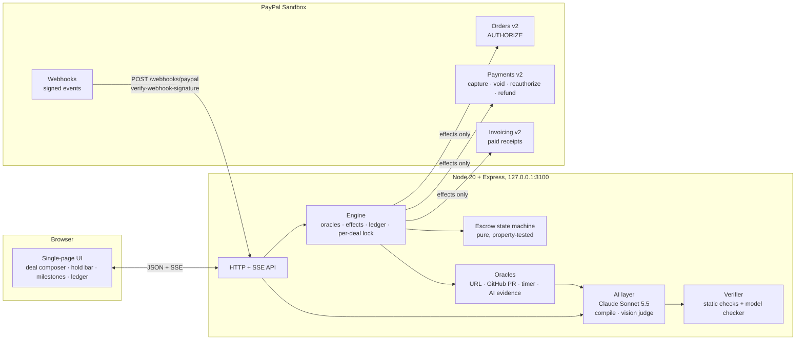

# Pactline

**Plain-English deals that pay themselves, held by PayPal.**
A freelancer and a client type their deal in plain English. AI compiles it into a typed payment contract, a model checker *proves* it can never lose or double-spend money, and the client's PayPal authorization hold guarantees the funds. Each milestone is captured automatically when its proof checks out. Nobody but PayPal ever holds the money.

> Built for the PayPal AI Hackathon. Runs entirely on the PayPal **sandbox**. MIT licensed.

## What it does

1. **Describe the deal** ("Landing page, $1,200: 30% when the staging URL is live, 50% when the design matches the mockup, 20% after 7 days with no open bugs; refund if not delivered by 30 Nov").
2. **Claude compiles it** into a contract (parties, hold, milestones with exact cents, how each is proven, deadline).
3. **A verifier checks it before any money moves.** Static checks (shares sum to 100%, cents add up exactly, every milestone has a way to be checked, no dependency cycles, deadline inside PayPal's hold window) plus a **model checker that walks every reachable execution of the real state machine** (204 paths for the demo contract) and asserts the invariants. Errors go back to the model for repair.
4. **The client funds it** with a real PayPal approval. PayPal creates an `AUTHORIZE` order; the money is held at PayPal, not by us.
5. **Each milestone releases itself** when its oracle passes: URL check, GitHub PR merged, a timer, or **Claude vision** judging a screenshot against the acceptance criteria. Each release is a **partial capture** of the same authorization plus a paid **receipt invoice** (Invoicing v2).
6. **Unsure? A human decides.** Low confidence or prompt-injected evidence goes to review with a neutral summary for both sides. A confident AI never overrides a doubt.
7. **Cancel or time out?** The unreleased remainder is **voided**: it never leaves the buyer. Money already released stays released.
8. **Everything is on the record.** A ledger lists every PayPal call with the PayPal ID, debug ID, HTTP status and the running held / captured / voided balance. **Real, signature-verified PayPal webhooks** reconcile state (they never move money).

## Architecture



**The one rule that makes it safe:** the state machine is pure and decides *what is allowed*; the engine only performs the machine's `effects` (capture N cents, void M cents). If PayPal rejects an effect the deal state is not changed. Two simultaneous clicks cannot release the same milestone twice (per-deal lock + machine rule + PayPal's own cap).

### PayPal APIs used
| API | Used for |
|---|---|
| Orders v2 `intent=AUTHORIZE`, `/authorize` | the client's hold (needs buyer approval in the PayPal popup) |
| Payments v2 `/authorizations/{id}/capture` (partial, repeated, `final_capture`) | releasing each milestone from one authorization |
| `/authorizations/{id}/void` | returning the unreleased remainder on cancel or timeout |
| `/authorizations/{id}/reauthorize` | keeping the hold alive after PayPal's 3-day honor period |
| `/captures/{id}/refund` | optional "refund released milestones on timeout" policy |
| Invoicing v2 (create, send, record payment) | a paid receipt invoice per released milestone |
| Webhooks + `verify-webhook-signature` | live reconciliation (`PAYMENT.CAPTURE.COMPLETED`, `PAYMENT.AUTHORIZATION.VOIDED`, ...) |

## Setup

Requires Node 20+.

```bash
git clone <this repo> && cd pactline
npm install
cp .env.example .env      # fill in the values below
npm start                 # http://127.0.0.1:3100
```

Without any keys it runs in **mock mode** (a faithful in-memory PayPal that enforces the same rules) with deterministic offline AI, so you can click through everything. `GET /api/status` tells you what is live.

### Going live on the PayPal sandbox
1. Create a **US** sandbox **Business** account and a **US Personal** (buyer) account in the [developer dashboard](https://developer.paypal.com/dashboard/accounts). *Important:* an India-based sandbox merchant rejects every currency at checkout (`UNSUPPORTED_PAYEE_CURRENCY`), so use US accounts and USD.
2. Create a REST app linked to the US business account and put its keys in `.env` (`PAYPAL_SANDBOX_CLIENT_ID`, `PAYPAL_SANDBOX_CLIENT_SECRET`). Enable the **Invoicing** feature on the app (or set `PAYPAL_INVOICING_CLIENT_ID/SECRET` to a second app that has it; receipts are best-effort and never block a release).
3. Put an Anthropic key in `ANTHROPIC_API_KEY` to switch on Claude (contract compiler and vision judge). Models: `claude-sonnet-5-5` (default), `claude-opus-5-5` for escalating unsure verdicts.
4. Webhooks (optional): expose **only** `POST /webhooks/paypal` publicly (`scripts/webhook-forwarder.mjs` + any tunnel), register the URL for your app, and set `PAYPAL_WEBHOOK_ID`. Signatures are verified with PayPal's API; unverified posts are rejected.
5. To approve the hold as the buyer in scripts/tests, set `PAYPAL_SANDBOX_BUYER_EMAIL` / `PAYPAL_SANDBOX_BUYER_PASSWORD` (sandbox only; used by `scripts/approve.mjs`, which needs `npm install` dev dependencies and Chrome).

### Run the tests
```bash
npm test          # state machine, verifier, 20,000 random event sequences, engine, HTTP API, AI layer (offline)
npm run smoke     # live: authorize -> capture 30% -> capture 50% -> void -> refund on the real sandbox
npm run e2e       # live: compile -> verify -> fund (scripted buyer) -> releases -> receipts -> cancel -> ledger
```

## How it is tested

- **Verifier**: each failure class (`SHARES_SUM`, `TOTAL_MISMATCH`, `NO_ORACLE`, `BAD_ORACLE`, `CYCLE`, `DEADLINE_AFTER_HOLD`, `HOLD_TOO_LONG`, `ZERO_AMOUNT`, ...) has a test.
- **Property tests**: 10,000 random event sequences per sample contract (sequential and parallel milestones with odd cents), invariants checked after *every* step: `captured ≤ held`, `captured + voided ≤ held`, no milestone released twice, captured equals the sum of released milestones, `captured + voided = held` at every terminal state, every path terminates.
- **Model checker**: enumerates all reachable states and execution paths of the real machine for each contract being created.
- **Engine tests**: concurrent double release captures once; a PayPal failure leaves state untouched; cancel voids exactly the remainder; timeout voids; timers release; ledger balances are exact.
- **Live e2e on the real sandbox** (see above): real approval popup driven by headless Chrome, real partial captures, void, receipts and signed webhooks.

## AI tools used

- **Claude Sonnet 5.5** (Anthropic API): compiles plain English into the contract (structured output + verifier repair loop) and acts as the evidence judge with vision (screenshots, photos, PDFs), returning verdict, confidence, reasons and whether it detected prompt injection in the evidence. **Claude Opus 5.5** re-checks unsure verdicts. Without a key, deterministic fallbacks keep everything runnable (and never auto-approve image-only evidence).
- **Claude Code** (Sonnet 5.5 and Opus 5.5) was used to write the code, tests and docs.
- No other models are used.

## Honest limits

- PayPal holds are for **short gigs**: an authorization is honored for 3 days and can be reauthorized within 29 days. The verifier refuses longer deadlines. For longer projects, settle each milestone as an automatic invoice instead.
- The demo has one freelancer (the sandbox business account). A real platform would onboard many freelancers with PayPal Partner Referrals; that is roadmap, not built.
- Sandbox only. Receipt invoices record the milestone payment against the merchant's invoicing app; in this build they come from a second sandbox app because the US app did not get the Invoicing scope.
- The AI judge can be wrong; that is why anything below 80% confidence, or with detected injection, goes to a human.

## License
MIT, see `LICENSE`.
