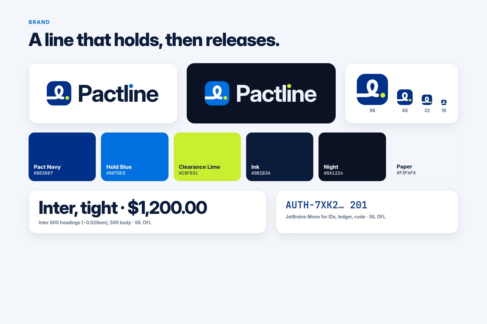

# Pactline brand

**Idea.** A line that connects two parties, ties a knot (the pact: money held by PayPal) and ends in a dot (the release). The symbol is drawn from one stroke: it enters from the edge, loops once, and stops just short of a lime dot. The gap before the dot is the checkpoint: proof has to clear it.



## Files

| File | Use |
|---|---|
| `logo-symbol.svg` | App icon / avatar, navy tile (light backgrounds) |
| `logo-symbol-dark.svg` | Same on dark backgrounds (Hold Blue tile) |
| `logo-symbol-mono.svg` | One-colour tile (black/white printing) |
| `logo-wordmark.svg` / `logo-wordmark-dark.svg` | Symbol + "Pactline", for light / dark backgrounds |
| `logo-mono.svg` / `logo-mono-white.svg` | Tile-less one-colour lockup (`currentColor`, default Ink) / white |
| `favicon.svg` | Separate 32-grid drawing with heavier strokes for 16 px |
| `favicon-32.png`, `apple-touch-icon.png` (180), `logo-512.png`, `logo-wordmark.png` | Raster exports, transparent |
| `social-preview.png` (1280×640) | GitHub social preview (Settings → Social preview) |
| `gallery-1..4-*.png` (1500×1000, 3:2) | Devpost gallery: hero, how it works, architecture, safety |

The wordmark is outlined from Inter Bold (SIL OFL), so it needs no font. The "i" is dotless; its dot is a separate circle (Hold Blue on light, Clearance Lime on dark).

## Copy into `public/` (UI owner)

```bash
cp assets/favicon.svg public/favicon.svg
cp assets/favicon-32.png public/favicon-32.png
cp assets/apple-touch-icon.png public/apple-touch-icon.png
cp assets/logo-symbol.svg public/logo-symbol.svg
```

```html
<link rel="icon" href="/favicon.svg" type="image/svg+xml">
<link rel="icon" href="/favicon-32.png" sizes="32x32">
<link rel="apple-touch-icon" href="/apple-touch-icon.png">
<meta property="og:image" content="/social-preview.png">
```

For the top-bar mark, inline the `<g>` from `logo-symbol.svg` at 30 px (the current inline mark in `public/index.html` is a placeholder).

## Palette

| Name | Hex | Role |
|---|---|---|
| Pact Navy | `#003087` | Tile, headings accent (PayPal-family, accent only) |
| Hold Blue | `#0070E0` | Held money, primary action, links (PayPal-family, accent only) |
| **Clearance Lime** | `#C8F031` | The release dot. Only ever on Navy, Hold Blue, Ink or Night (fails contrast on white) |
| Ink | `#0B1B3A` | Text |
| Night | `#0A1224` | Dark surfaces |
| Paper | `#F3F6FA` | Light page background |

Why lime: PayPal's blues say "trusted money"; Pactline adds one signal colour for the moment money is *cleared*. Lime is the complement to the blues, unused by PayPal (whose accents are blue and the old yellow) and distinct from the UI's state colours (released green `#0B7A3E`, amber, red), so the brand dot never reads as a status.

## Type

- **Inter** (SIL OFL): 800 for headings, tracking −0.028em; 500 for body. Tabular numerals for money.
- **JetBrains Mono** (SIL OFL): PayPal IDs, ledger rows, code.
- In the app, the UI keeps its system stack (`"Helvetica Neue", Inter, system-ui`) so it works offline.

## Don'ts

No gradients or glows on the symbol, no rotating it, no lime on white, no outlines around the tile, never put the PayPal logo inside the lockup.

## Regenerating the images

The HTML sources are in `docs/visuals/`. `node docs/visuals/render.mjs` re-renders every PNG at its exact size with headless Chrome (`playwright-core`, a dev dependency; set `CHROME=/path/to/chrome` if it is not `/usr/bin/google-chrome`).
